# Backend Class Diagram

Stack: FastAPI (routers) → service layer → SQLAlchemy models, Alembic migrations, pytest.

The diagrams are split by component so each one stays readable:

1. Component overview
2. Identity & Access
3. Student & Academic Records
4. Rule Configuration
5. Risk Management
6. Feasibility & Planning
7. Intervention Management
8. Notification Management
9. Audit log
10. Job Scheduler
11. Service layer
12. Persistence boundary

In the component diagrams, a class marked `<<external>>` belongs to another
component and is shown without members only so the relationship can be drawn.

## 1. Component overview

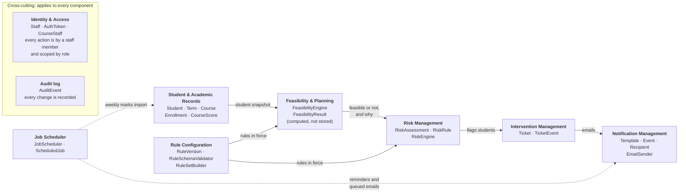

Left to right is the flow of data: student records feed the feasibility check, its result
drives risk flags, flags lead to tickets, and tickets produce emails. Rule Configuration
supplies the versioned rules that feasibility and risk detection both read. Job Scheduler starts
the weekly marks import and sends reminders and queued emails. Identity & Access and Audit log apply
to every component (every action is performed by a staff member and limited by role, and every
change is recorded), so they are shown as a separate group instead of with an arrow to each box.

## 2. Identity & Access

A Lead can do everything a Member can, and an Instructor everything a TA can, so the
hierarchy is two chains under `Staff`. A TA is limited to assigned courses and cannot stand
in for a Member, so the two chains are kept apart. The `role` column is the single source of
truth; `StaffFactory` builds the matching subclass from it, so class and column cannot
disagree. Who may see which record is decided in one place, `AccessPolicy`, not on `Staff`.
The methods here are thin: each delegates to a service.

A Course TA belongs to exactly one course, while an Instructor can manage several. The
`course_staff` table cannot enforce this on its own, because the role lives on the staff row,
so `StaffService` rejects a second course for a TA when it approves the assignment.

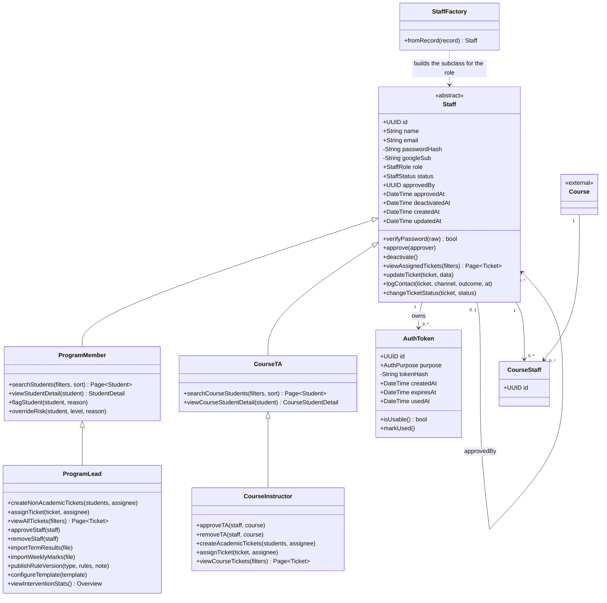

## 3. Student & Academic Records

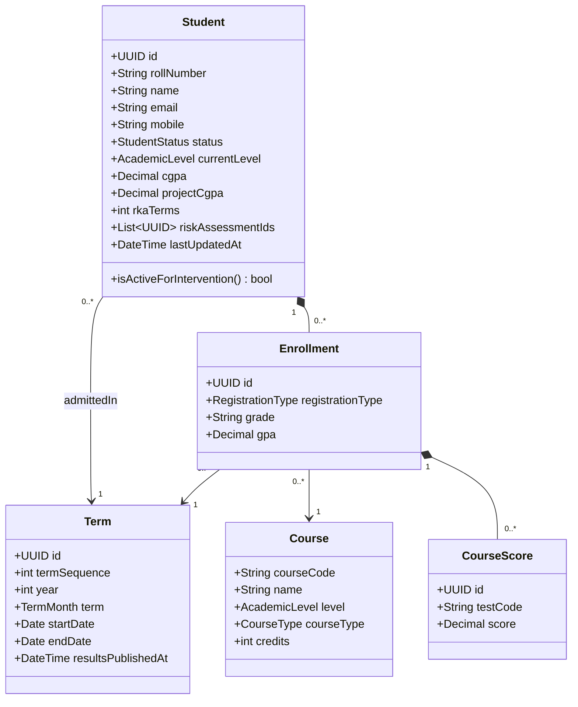

## 4. Rule Configuration

Rules are configuration, not logic. Course requisites (pre- and co-requisites), milestone
criteria and CGPA criteria are each stored as an immutable `RuleVersion`. Every change adds a
new version and old versions are never edited, so any past decision can be traced to the rules
in force at the time. Rules are stored as JSON and checked against a schema before saving, so
malformed rules are rejected. `RuleSetBuilder` turns the versions in force for a student's
admission term into the `RuleSet` that risk detection and feasibility both use. The leadership
email sent after a rule change is built by `RuleChangeReport` in Notification Management.

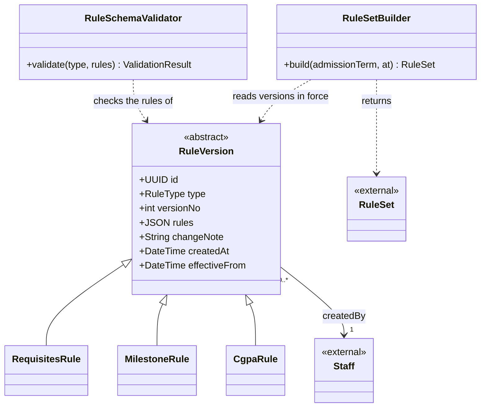

## 5. Risk Management

Risk detection is open for extension. `RiskEngine` runs whichever `RiskRule`s are registered,
so a new indicator is a new class and needs no change to the engine. Suggesting interventions
is a separate class from detecting risk. `riskLevel` is one of four values, listed below from least to most
serious, and is a database enum (`risk_level`). An override never edits an assessment: it adds a new one with source
`manual` that replaces the automated one, and records the reason, the staff member and the date. An assessment does not link to a rule
version, so its `explanation` must name the rule that triggered it and the version in force. An
`academic` assessment always carries a course and a `non_academic` one never does, which a CHECK
constraint enforces.

| `risk_level` value | Position (least to most serious) |
|---|---|
| on_track | 0 |
| watch | 1 |
| at_risk | 2 |
| critical | 3 |

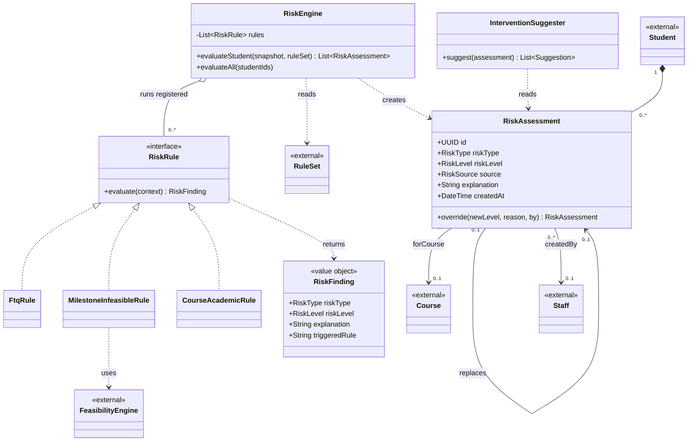

## 6. Feasibility & Planning

A computation component with no tables of its own. It builds a snapshot of a student's
standing, applies the active rules, and returns whether the next milestone is reachable and
why. The result is stored only as the `explanation` on a `RiskAssessment` or in an email body.
All classes here are plain value objects except the engine, so it is easy to unit test.

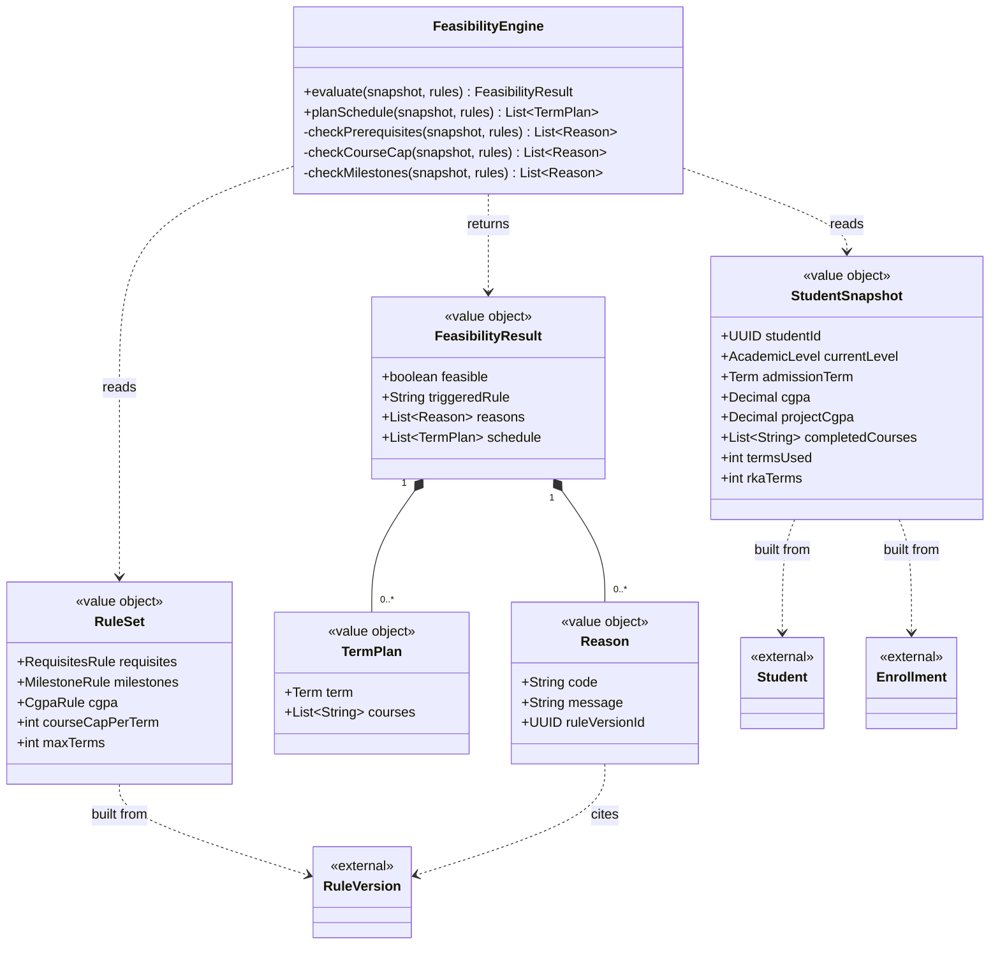

## 7. Intervention Management

Every ticket must reference a risk assessment (`risk_assessment_id` is required). When a staff
member creates a ticket for a student the system has not flagged, `TicketService` first records
a manual `RiskAssessment` (source `manual`) and links the ticket to it. Ticket type is derived:
a ticket with a `course_code` is academic, otherwise it is non-academic.

Who may do what with tickets is decided in `AccessPolicy`:

- **Create and assign:** non-academic tickets are created and assigned only by Program Leads,
  academic tickets only by the Course Instructor of that course. Staff cannot assign an
  unassigned ticket to themselves.
- **View:** a Lead sees all tickets, a Program Member sees non-academic tickets assigned to them,
  an Instructor sees all tickets of the courses they manage, and a TA sees tickets assigned to
  them in their one course.
- **Work (edit, log contact, change status):** a Lead works only on non-academic tickets. A Lead
  can view academic tickets but cannot change them.
- **Deactivation:** when a staff member is deactivated, their tickets go back to unassigned and
  wait for a Lead (non-academic) or Instructor (academic) to assign them again.

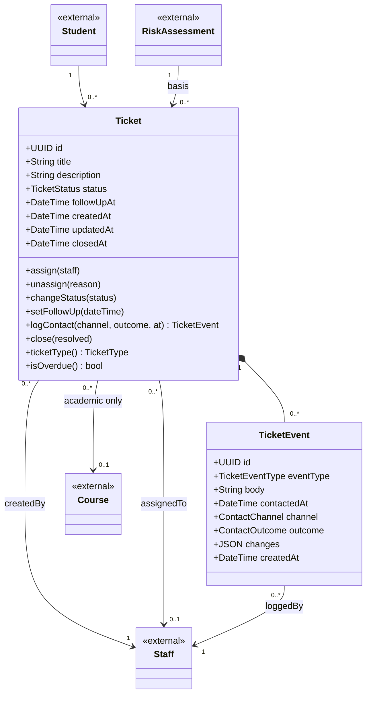

## 8. Notification Management

Every student-facing feature, the leadership reports, rejected-record notices, follow-up
reminders and password-reset links go through this component. Other components queue a
`NotificationEvent`; the dispatcher delivers it through the `EmailSender` interface. Only the
SMTP implementation reads mail credentials (from environment variables), and tests replace it
with a fake sender. Each report is its own `ReportGenerator`, so adding a report means adding
a class, not editing `ReportService`.

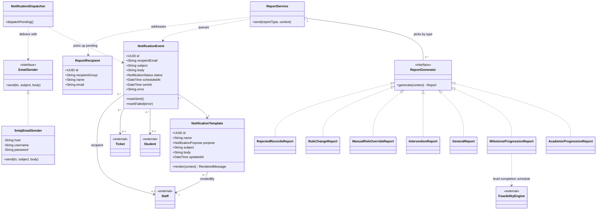

## 9. Audit log

A cross-cutting record of who did what. Every service writes to it through `AuditService`;
nothing reads it except the audit query endpoint. Events are append-only.

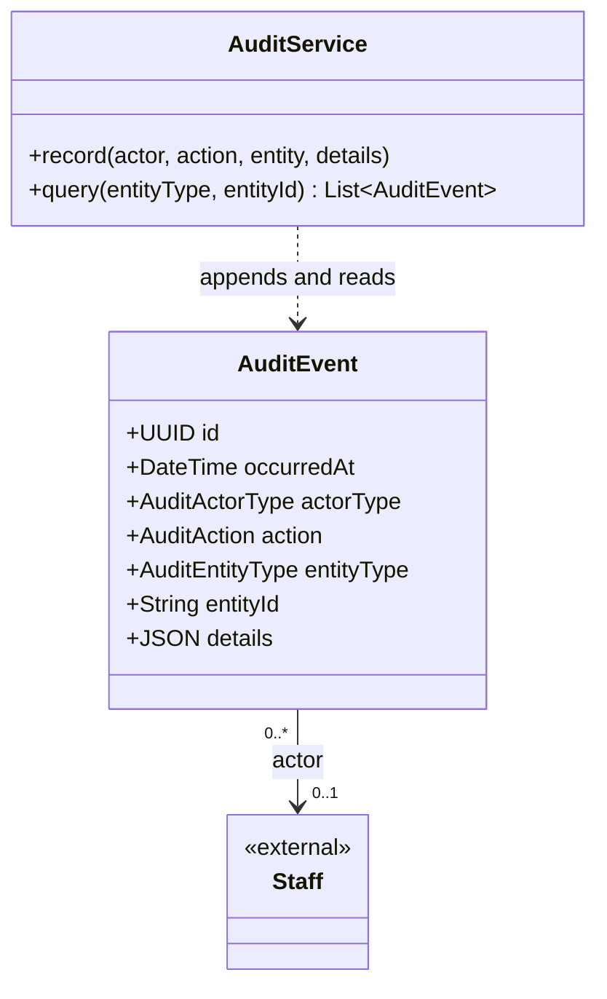

### Enumerations

Values below are the database enums, exactly as defined in the schema. The class diagram
types are the PascalCase form of the database names (for example `StaffRole` is `staff_role`).

| Database enum | Values |
|---|---|
| `staff_role` | program_lead, program_member, course_instructor, course_ta |
| `staff_status` | invited, pending_approval, unverified, rejected, active, deactivated |
| `auth_reason` (AuthPurpose) | invite, verify_email, reset_password |
| `course_type` | theory, project |
| `academic_level` | foundation, diploma |
| `term_month` | jan_t1, may_t2, sep_t3 |
| `student_status` | active, removed, withdrawn, graduated |
| `rule_type` | requisites, milestones, cgpa |
| `course_registration_type` (RegistrationType) | new_course, improvement, repeat_end_term_only, repeat_oppe_only, repeat_oppe_end_term, repeat_full_course |
| `risk_source` | automated, manual |
| `risk_type` | no_risk, academic, non_academic(milestones) |
| `risk_level` | on_track, watch, at_risk, critical |
| `ticket_status` | unassigned, open, in_progress, resolved_and_closed, unresolved_and_closed |
| `ticket_event_type` | comment, contact_attempt, created, edited, status_changed, follow_up_changed, reassigned |
| `contact_channel` | email, phone, whatsapp, other |
| `contact_outcome` | no_response, follow_up_needed, resolved |
| `notification_purpose` | intervention_email, follow_up_reminder, academic_progression_report, milestone_progression_report, rule_change_report, general_report, intervention_report, manual_risk_override_report |
| `notification_status` | pending, sent, failed |
| `audit_actor_type` | staff, system, unknown |
| `audit_action` | password_reset_requested, password_reset_completed, password_changed, login_succeeded, login_failed, staff_registered, staff_approved, staff_rejected, staff_deactivated, staff_reactivated, staff_role_changed, rule_version_published, risk_assessment_run, import_accepted, import_rejected, template_created, template_updated, report_recipient_added, report_recipient_removed |
| `audit_entity_type` | staff, course, course_staff, term, student, rule_version, risk_assessment, data_import, notification_template, report_recipient |

### Derived values

The class diagram uses these, but the schema has no column for them. They are computed.

| Value | How it is derived |
|---|---|
| `Ticket.ticketType()` (academic or non-academic) | academic when `course_code` is set, otherwise non-academic |
| A student's current risk assessment | derived from the assessments listed in `students.risk_assessment_id`; earlier ones are reached through `replaces_id` |
| Courses per term | enrollments grouped by term (RKA terms are stored on the student as `rka_terms`) |
| Reminder already sent | a `follow_up_reminder` notification event exists for the ticket |
| Import outcome | `ImportResult` returned to the caller; the error summary is kept in `audit_events.details` under `import_accepted` or `import_rejected` |

## 10. Job Scheduler

Only work that must happen at a particular time without a person starting it runs here: the
weekly import of course marks (for example every Monday), follow-up reminders, and the delivery
of queued emails. Term results are not scheduled: a Program Lead imports them by hand, and
`ImportService` recomputes risk for the updated students as part of every import, scheduled or
manual. The weekly job gets its file from `MarksFeed`, an interface. The Registration & Exam Office
shares the files and the application imports them, so the one implementation, `FileMarksFeed`,
picks up the latest file from a configured location (not final yet, and set through an
environment variable). If the arrangement changes, only that class changes. A scheduled import
runs as the system, not as a staff member, and is audited as such. If a file is rejected, the
Program Lead and the Registration & Exam Office are both notified of the rejected records, and
the Lead can upload the weekly file by hand, which goes through the same `ImportService` call.
If no file has arrived by the scheduled day, the job records the run as skipped and notifies the
same two parties that the file is missing. A job
is only a trigger: it holds no business rules and calls the service that does the work. Each job
is its own class and is registered with a schedule, so adding a job means adding a class, not
editing the scheduler.

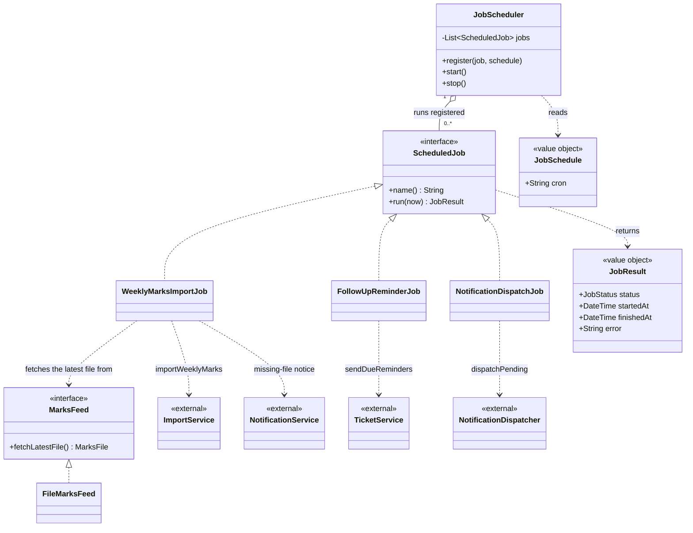

## 11. Service layer

Routers stay thin: they validate input (Pydantic), call one service, and map domain
errors to HTTP responses. Services own the business rules and write `AuditEvent`s.
`RiskEngine`, `ReportService` and `AuditService` are defined in their own component
diagrams and shown here as external. Services read and write data through the repository
interfaces in section 12, never through the database directly.

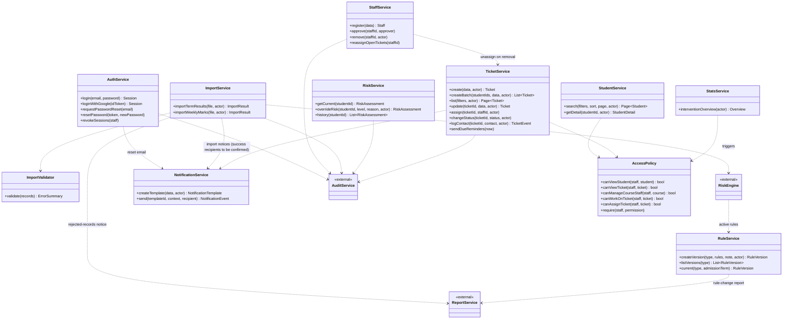

## 12. Persistence boundary

Services depend on these interfaces, not on SQLAlchemy. Each repository has a SQLAlchemy
implementation in production and an in-memory one in unit tests. All times are stored and
compared in UTC. Time-dependent logic, such as the 15-minute reminder, takes `now` as an
argument, so tests can pass any time they like.

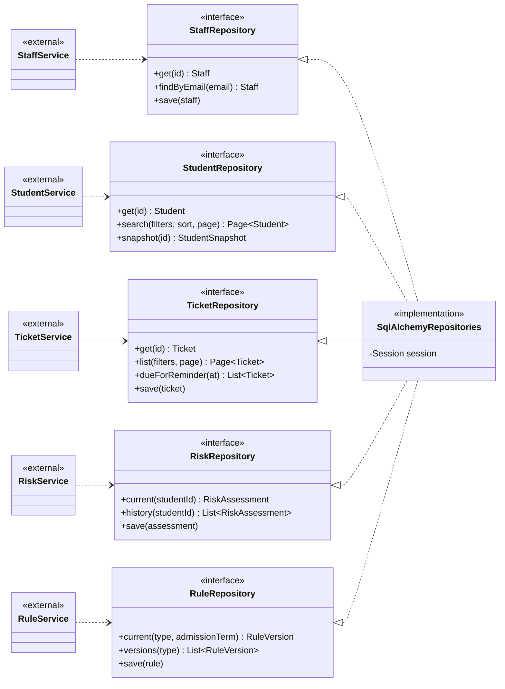

### Router → service mapping (to carry into the OpenAPI file)

| Router | Service | User stories |
|---|---|---|
| `/auth` | AuthService | login, password reset |
| `/staff`, `/courses/{code}/staff` | StaffService | approve and remove members, instructors, TAs |
| `/students` | StudentService, RiskService | directory, detail, override |
| `/imports` | ImportService | atomic record import |
| `/tickets` | TicketService | create, assign, filter, contact log, status |
| `/rules` | RuleService | versioned requisites, milestones and CGPA rules |
| `/templates`, `/notifications` | NotificationService | templates and sending |
| `/stats`, `/reports` | StatsService, ReportService | dashboard and emailed reports |
